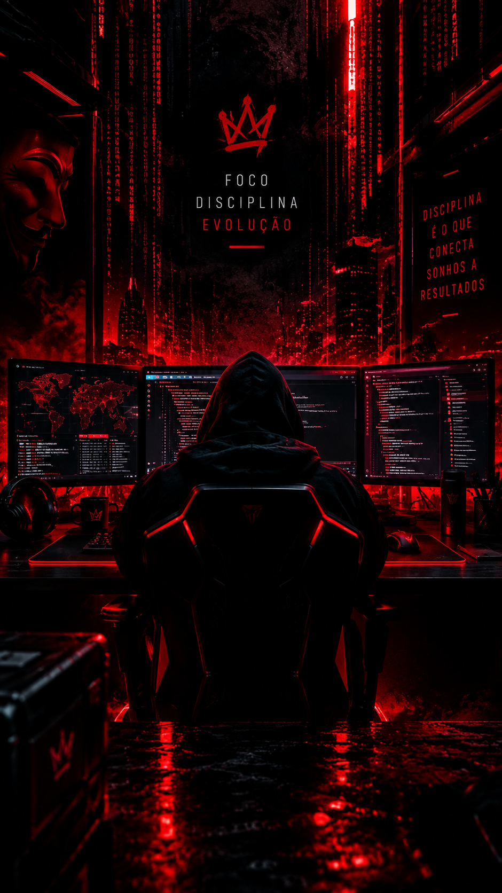

<div align="center">

<div align="center">
  
</div>

# 🔴 RAFAEL <span></span>

### `CODE` / `LEARN` / `BUILD` / `EVOLVE`

**Sonhe. Planeje. Codifique. Conquiste.**

[](https://github.com/khaolzera-ai)
[](https://developer.mozilla.org/pt-BR/docs/Web/JavaScript)
[](https://www.python.org/)

</div>

---

## 🔥 01 — SOBRE MIM

Fala, dev! 👋

Sou Rafael, estudante de programação Frontend/Backend e Mobile, começando minha jornada no mundo da tecnologia.

🎯 **Nível atual:** Iniciante  
📚 **Foco:** JavaScript/CSS/HTML/Java/Pynthon/PHP...  
⚡ **Mentalidade:** Aprender hoje. Construir o amanhã.

Acredito que cada erro é uma oportunidade de aprender e cada projeto é um passo rumo à evolução.

---

## 🎮 02 — STATUS 

| Habilidade | Status |
|---|---|
| 🧠 Lógica de programação | Em treinamento |
| ⚡ JavaScript | Em aprendizado |
| 🐍 Python | Em aprendizado |
| 📊 Ciência de Dados | Em aprendizado |
| 🚀 Desenvolvimento de projetos | Em construção |

**LEVEL 01 — INICIANTE**

`████░░░░░░` Evoluindo um passo por vez.

---

## 🛠️ 03 — ARSENAL TECNOLÓGICO

<div align="center">


</div>

---

## 🎯 04 — MISSÕES ATIVAS

- [ ] Dominar a lógica de programação.
- [ ] Entender `if`, `else`, `while`, `do...while` e `for`.
- [ ] Criar meus primeiros projetos com JavaScript.
- [ ] Aprender Python e outras linguagens.
- [ ] Resolver problemas com código.
- [ ] Construir um portfólio de projetos reais.

> Pequenos passos. Grandes sonhos. 🔥

---

## 💻 05 — CÓDIGO EM AÇÃO

```javascript
const rafael = {
    nome: "Rafael",
    foco: ["JavaScript", "Python", "Data Science"],
    nivel: "Iniciante",
    objetivo: "Evoluir todos os dias",
    mentalidade: "Sonho + Código = Realidade"
};

console.log("Bora pro próximo level! 🚀");
```

---

## 🚀 06 — PROJETOS

Confira meus repositórios e acompanhe minha evolução:

<div align="center">

[](https://github.com/khaolzera-ai?tab=repositories)

</div>

---

## 📊 07 — ESTATÍSTICAS DO GITHUB

<div align="center">


</div>

---

<div align="center">

### 🔴 GAME ON — NEVER GIVE UP.

**Foco • Disciplina • Estudo • Progresso**

*Construindo meu futuro, uma linha de código por vez.*

</div>
